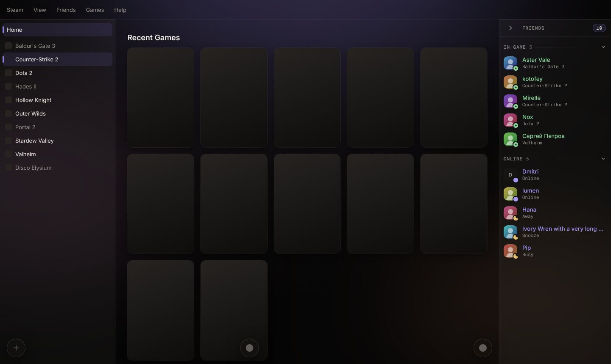
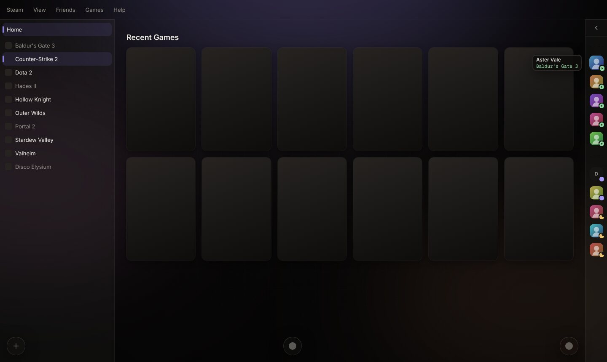
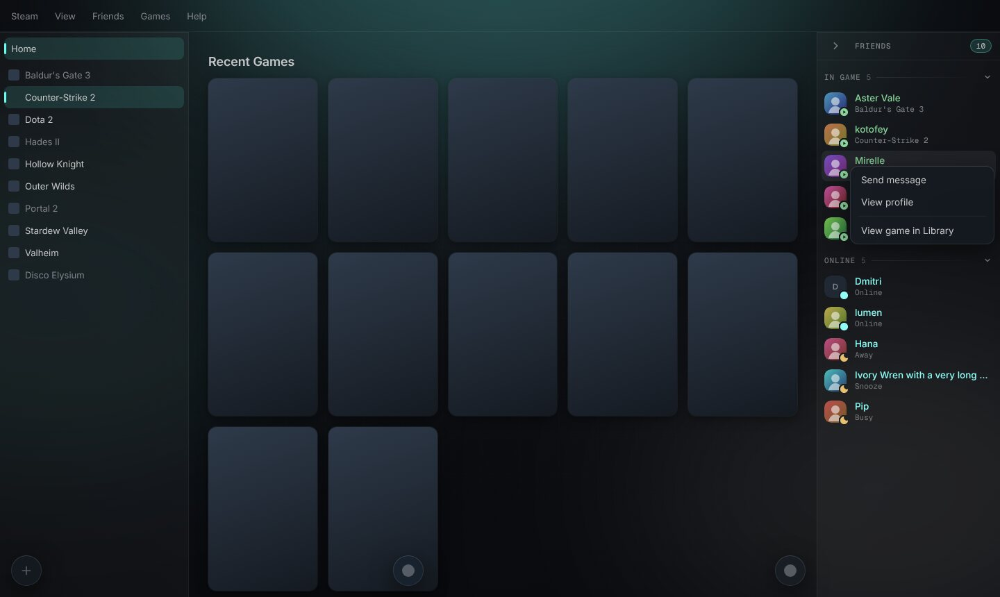

<div align="center">

# Aika Enhanced

**[Aika](https://github.com/hatewxb/Aika), the warm dark Steam theme by hatewxb, with a Friends Dock at the right of the library** · [Millennium](https://steambrew.app) · 0.1.8-enhanced.1



</div>

Aika Enhanced is the original Aika 0.1.8 (library, header, game cards and pages,
store, profiles, friends window, overlay, presets, motion, settings) with one
addition: a friends column at the right edge of the library. Its behaviour comes
from the Friends dock of [Steam Enhanced](https://github.com/NVHT/Steam-Enhanced)
by NVHT; its look is Aika's own. It is the left game list mirrored on the right:
the same translucent surface and hairline edge, rows with the same inset, radius
and hover, the friends window's status badges cut out of squircle faces, its mono
group captions, Steam's tooltip and Aika's menu. Every color comes from the
current preset (or your custom colors), so switching the preset recolors the dock
with the rest of the window.

For everything Aika does, see the [original README](https://github.com/hatewxb/Aika#readme).

## Friends Dock

| Expanded | Collapsed (with the tooltip) |
|:--:|:--:|
|  |  |
| **Grouped by game, offline shown, Greeny** | **A friend's menu, Hello Bert** |
|  |  |

<sub>The screenshots come from the test harness (`tests/friends-dock/`), with
placeholder friends and covers, not from a Steam client.</sub>

- **Your real friends**, read from the Steam client itself (its Friends store): names
  and nicknames, avatars, status, the game and what they do in it. No Steam Web API
  key, no network requests.
- **Two states.** Expanded (264 px by default): faces, names, the game or status,
  the online count, groups **In game** and **Online** (and **Offline**, off by
  default). Collapsed: a 52 px rail of faces with status badges; hovering a face
  shows the name and the game.
- **Live.** Friends appear when they sign in, leave when they sign out, move
  between groups when they start or stop a game; only the rows that changed are
  touched.
- **Click** a friend to open the Steam chat. **Right-click** for Send message,
  View profile and View game in Library. Keyboard: Tab, Enter, the menu key,
  arrows and Escape in the menu.
- **Part of the library**: it starts under the header, the library gives up
  exactly its width (no overlap, no horizontal scroll), the floating library
  icons move with it, it leaves on store and community pages and in the mini
  "Steam Games List" window, and the window below 1100 px folds it to its rail.
- **Remembers** expanded / collapsed and the folded groups across restarts.
- **Animations** in Aika's timing: the width and the library room ease together,
  names fade in after the dock opens, faces grow under the cursor like the
  library icons, new friends rise in like Aika's panels. *Performance: Low*,
  the dock's own switch and the system's "reduce motion" turn them off.

### Settings — Millennium → Themes → Aika Enhanced → ⚙ → **Friends Dock**

| Setting | Values | |
| --- | --- | --- |
| Friends Dock | **On** / Off | Off: the library exactly as in Aika, no room left over |
| Dock at startup | **Last state** / Expanded / Collapsed | |
| Expand on hover | On / **Off** | The rail opens over the library while hovered |
| Dock: friends in game | **On** / Off | |
| Dock: friends online | **On** / Off | |
| Dock: offline friends | On / **Off** | Folded until opened, last seen first |
| Dock: group by game | On / **Off** | Each game with its icon and player count |
| Dock: friend count | **On** / Off | |
| Dock animations | **On** / Off | |
| Dock width | 240–320 px, **264** | |
| Dock avatar size | 28–40 px, **32** | The rail follows (face + padding) |
| Dock opacity | 0–100 %, **0** | 0 % = the game list's surface, 100 % = an opaque panel |

The dropdowns apply at once in the open window (Aika's live settings bridge,
extended); the sliders are applied by Millennium — if one does not change the
dock right away, restart Steam. Settings are in English and, with Steam in
Russian, in Russian, like the rest of Aika's settings.

## Installation

Requires [Millennium](https://steambrew.app) and theme scripts enabled.

### With the installer

Windows (PowerShell):

```powershell
powershell -ExecutionPolicy Bypass -File install\install.ps1
```

Linux:

```sh
./install/install.sh
```

The installer finds Steam (registry on Windows; the usual native, Flatpak and Snap
folders on Linux) and Millennium's themes folder, moves an existing
`Aika-Enhanced` folder to `aika-enhanced-backups/<time>/` beside the themes
folder, and copies the theme to `<themes>/Aika-Enhanced`. It changes nothing
else — no other theme, plugin, Millennium config or Steam file — needs no admin
rights, and closes Steam only with `-Restart` / `--restart` and after asking. If
it cannot find the themes folder, open Steam → Millennium → Themes, press the
folder button and pass that folder: `-ThemesDir "<folder>"` /
`--themes-dir "<folder>"`. `-DryRun` / `--dry-run` shows what it would do.

### By hand

Copy this folder (without `tests`, `tools`, `install`) into Millennium's themes
folder as `Aika-Enhanced`.

### Then

Steam → **Millennium** → **Themes** → **Aika Enhanced**; enable theme scripts if
asked. Fully restart Steam after the first install. Aika Enhanced is a separate
theme: the original Aika (if installed) stays as it is; only one theme is active
at a time.

## Compatibility

Built on Aika 0.1.8 and tested against its structure. Windows 10/11 and Linux,
like Aika (on Linux the dock waits for Aika's class compatibility adapter, as
Aika's own scripts do). Any window size and UI scale: the dock measures the header
and the window instead of assuming sizes. All four presets and custom colors.
No Steam files are modified and no protections are touched.

## Development

```sh
python3 -m http.server 8765 --bind 127.0.0.1 --directory /
node --test tests/friends-dock.e2e.cjs          # needs Playwright + Chromium
AIKA_ORIGINAL=/path/to/Aika node --test tests/friends-dock.e2e.cjs   # + pixel parity with Aika
node --test tests/*.test.mjs tests/*.test.cjs   # Aika's own tests
```

Files added or changed compared with Aika 0.1.8: see [CHANGELOG.md](CHANGELOG.md).

## Authors and licenses

**Aika** — hatewxb. **Steam Enhanced** (the Friends dock behaviour, MIT) — NVHT.
See [LICENSES/README.md](LICENSES/README.md), including an important note: the
Aika repository publishes no license, so ask its author before redistributing
Aika Enhanced publicly.
