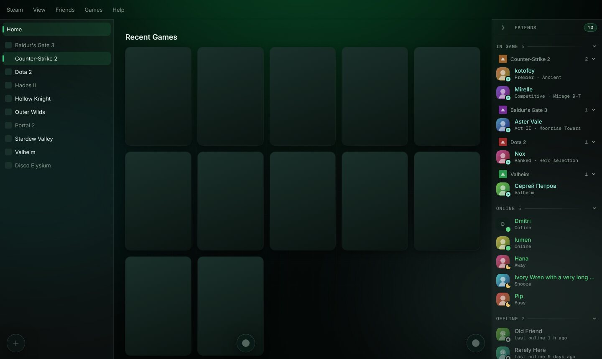
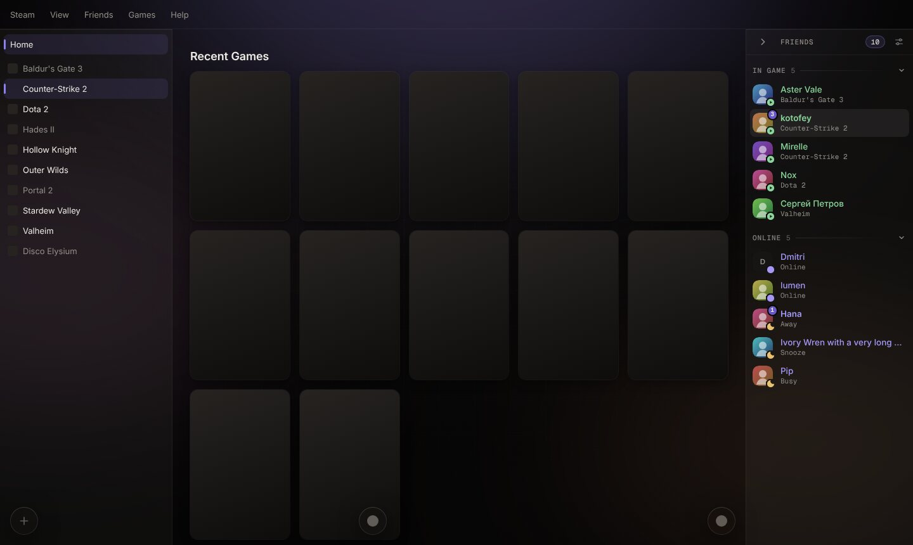
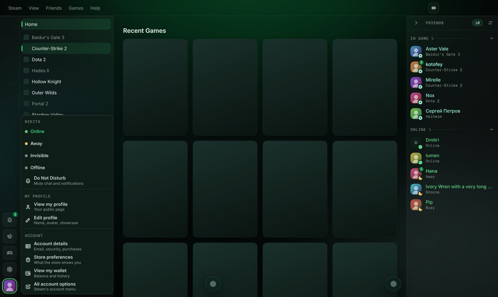
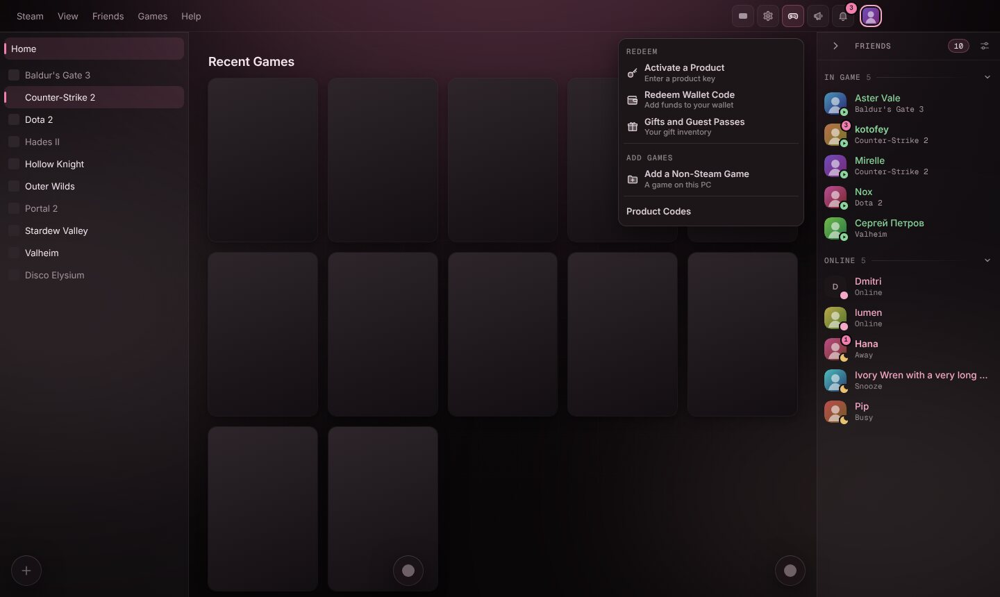
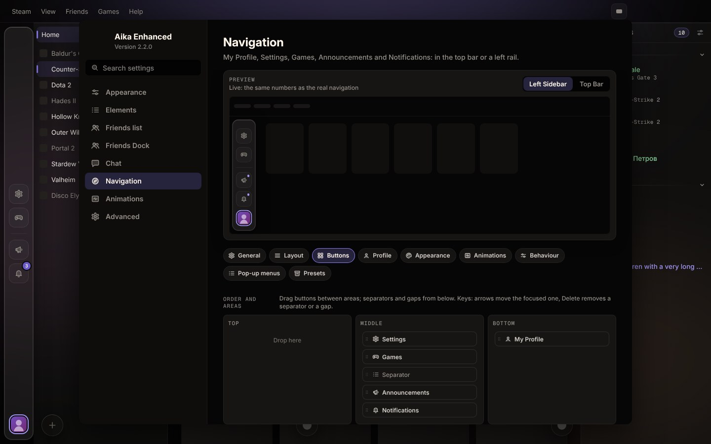
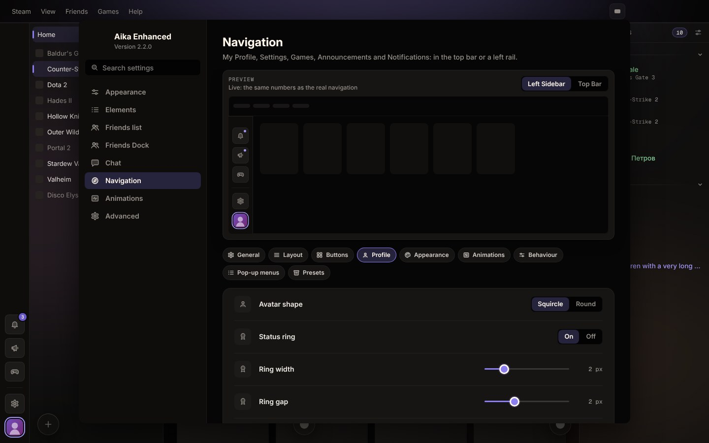
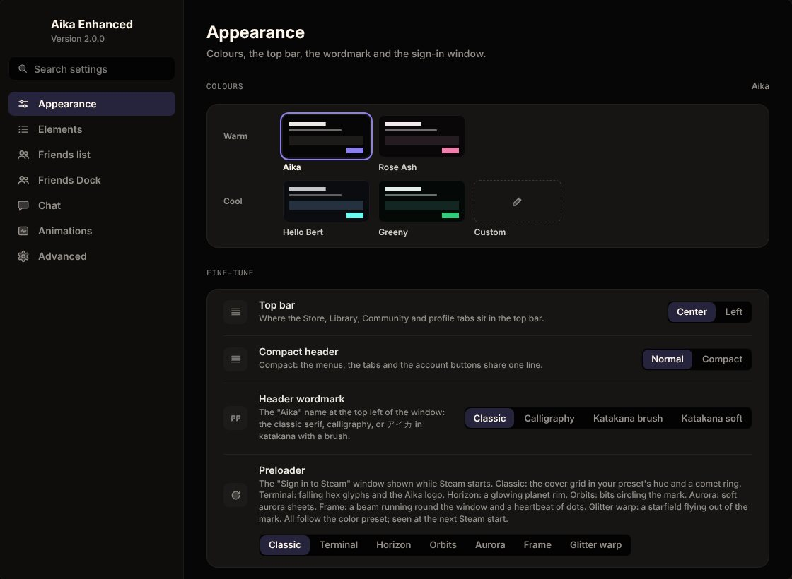
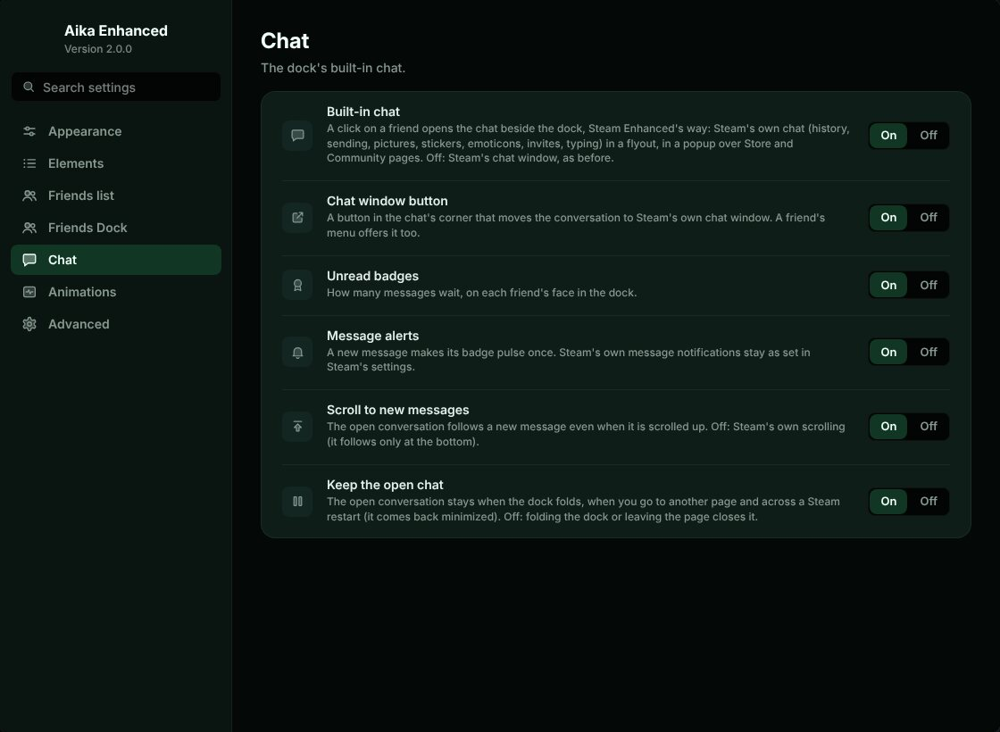
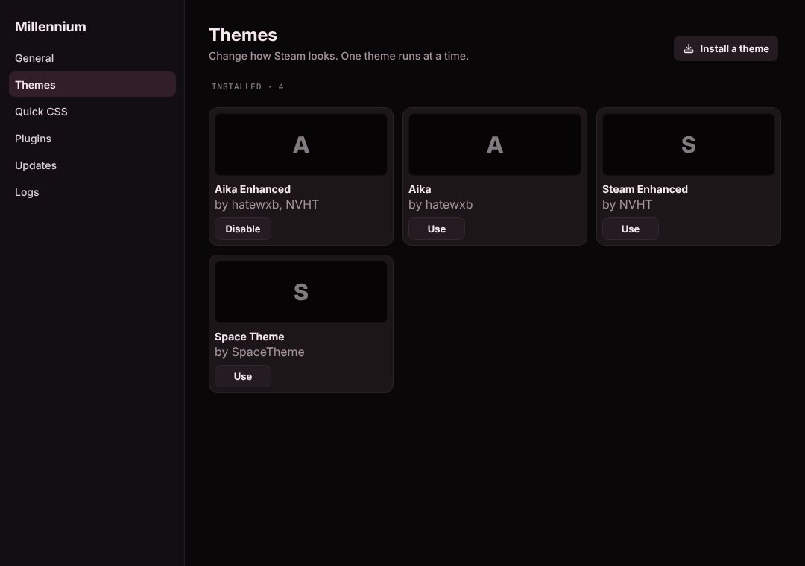

<div align="center">

# Aika Enhanced

**[Aika](https://github.com/hatewxb/Aika), the warm dark Steam theme by hatewxb — with a Friends Dock and its built-in chat on every page, and [Steam Enhanced](https://github.com/NVHT/Steam-Enhanced)'s Millennium Settings** · [Millennium](https://steambrew.app) · 2.5.0


</div>

Aika Enhanced is the original Aika 0.1.8 (library, header, game cards and pages, store,
profiles, friends window, overlay, presets, motion, settings) with what Steam Enhanced does best,
drawn in Aika's look:

- **The Friends Dock** — a friends column at the right edge of the window: beside the library,
  the Store, the Community (profiles, Workshop, inventory, Market) and the other pages. One dock and
  one state for every page.
- **Its built-in chat** — a click on a friend opens the conversation beside the dock, Steam
  Enhanced's way: Steam's own chat, in an Aika panel.
- **Steam Enhanced's Millennium Settings** — its whole design of Millennium's window, and its theme
  settings window holding every Aika Enhanced setting — in the colours of your Aika preset.

The dock is Aika's left game list mirrored on the right: the same translucent surface and hairline
edge, rows with the same inset, radius and hover, the friends window's status badges cut out of
squircle faces, its mono group captions, Steam's tooltip and Aika's menu. Every colour comes from the
current preset (or your custom colours). For everything Aika does, see the
[original README](https://github.com/hatewxb/Aika#readme).

## Friends Dock

| Expanded | Collapsed (with the tooltip) |
|:--:|:--:|
|  |  |
| **Grouped by game, offline shown, Greeny** | **Unread messages** |
|  |  |

<sub>Screenshots from the test harness (`tests/friends-dock/`) with placeholder friends and covers,
not from a Steam client.</sub>

- **Your real friends**, read from the Steam client itself (its Friends store): names and
  nicknames, avatars, status, the game and what they do in it, unread messages. No Steam Web API
  key, no network requests, nothing sent anywhere.
- **Two states.** Expanded (264 px by default): faces, names, the game or status, the online count,
  groups **In game**, **Online** (and **Offline**, off by default). Collapsed: a 52 px rail of faces;
  hovering a face shows the name and the game.
- **On every page.** Store, Community, profiles and the other pages are Steam's native browser
  view, drawn over the main window. The page keeps the rail's room beside it. The open dock (and
  the hover peek) is drawn over the page in one of Steam's popup windows, at the window's right
  edge. It is the same dock, its header and list moved there and back, as its tooltips, menus and
  the built-in chat already are. Expanded/collapsed, the scroll position and the open chat stay as you move
  between pages. Each kind of page can be switched off.
- **Live**: friends appear and leave, move between groups, unread counts pulse when a message
  arrives; only the rows that changed are touched.
- **Right-click**: Send message, View profile, Open in a Steam chat window, View game in Library.
- **Remembers** expanded / collapsed, the folded groups and the open conversation across restarts.

## Built-in chat

A click on a friend opens the conversation in a panel beside the dock (on Store and Community pages,
in a Steam popup window over the page). This is **Steam Enhanced's chat engine**, carried over
unchanged: Steam's own Friends & Chat tree mounted in the dock and its chat shown as a flyout, so
what's inside is Steam's chat itself — history, new messages, sending, timestamps, avatars and
names, pictures, stickers, emoticons, links, game invites, the typing indicator, message menus,
several conversations as tabs. Minimize it to a chip, close it, or move it to Steam's chat window
with the button in its corner. The look is **Aika's own chat style** (the one Aika gives Steam's
chat window) inside an Aika floating panel. If a Steam update stops the chat from being embedded, a
click opens Steam's chat window instead.

## Navigation

Steam Enhanced's navigation, only the parts that matter here, in Aika's look: **My Profile** (your
avatar in a ring that shows your status, and its menu: the states, Do Not Disturb, your profile, your
account), **Settings** (Steam's, the theme's, Millennium, the Library Manager), **Games** (Steam's
Games menu: activate a product, redeem a wallet code, gifts, add a non-Steam game, restore a backup),
**Announcements** (Steam's news, a dot while unread) and **Notifications** (Steam's own, its count as
a badge). *Navigation layout*: **Top Bar** (in the header's row, menus drop down) or **Left Sidebar**
(a narrow rail at the left, menus open beside it). Downloads, Aika's other buttons and the Friends
Dock stay where they are.

| Left Sidebar, the profile menu (Greeny) | Top Bar, Games (Rose Ash) |
|:--:|:--:|
|  |  |

### Customising the navigation (2.2)

**Theme settings › Navigation** is an editor with a live preview that uses your real avatar and
status. Every change also applies to the real navigation at once. The Left Sidebar and the Top Bar
each keep their own sizes, order and visible buttons. The categories:

- **General** — the layout, which layout you're editing, and a full reset back to 2.1.0's look.
- **Layout** — width / bar height; button, icon and avatar size; spacing; inner padding; outer
  margin; button and panel radius; border; alignment.
- **Buttons**:
  - drag and drop (or arrow keys) between the rail's top / middle / bottom, or the top bar's
    left / middle / right;
  - separators and gaps;
  - hide any button, and the rest close up;
  - unread indicators, tooltips, separators, button background and borders on or off.
- **Profile** — squircle or round; the ring with its width, gap and glow; a pulse on status change;
  name / status / game beside the avatar; a status dot; a colour for each Steam state.
- **Appearance** — Aika (default), Minimal, Glass, Transparent, Solid or Custom: panel and button
  opacity, blur, hover and active intensity, borders, shadow, glow, accent.
- **Animations** — on/off, speed, hover style, press, menu opening, tooltips, the ring, new
  notifications, the layout switch.
- **Behaviour** — auto-hide (the rail comes back at the window's left edge), delays, compact mode,
  icons / icons and names / names on hover, closing menus, tooltip delay.
- **Pop-up menus** — width, radius, opacity, blur, font, row height, icons, speed, separators for
  My Profile, Settings, Games and Announcements.
- **Presets**:
  - built-ins: Original Aika Enhanced, Steam Enhanced Style, Minimal Sidebar, Compact Top Bar,
    Glass Navigation;
  - your own: save, rename, duplicate, update, delete;
  - JSON export and import, checked value by value.

Each category has its own reset button. If Settings is hidden, the theme's settings are still in
My Profile's menu, the dock's sliders button, Millennium's *All Aika Enhanced settings* and
Ctrl+Shift+`.

| Buttons, Glass Navigation | Profile, Steam Enhanced Style |
|:--:|:--:|
|  |  |

**What it can't change:**
- Steam's own Notifications and account menus are Steam's windows, so the pop-up menu settings
  don't reach them.
- Over Store and Community pages nothing can be drawn over the page. There, an auto-hidden rail
  moves the page aside when it comes out, and *names on hover* falls back to tooltips.

## Settings

Two ways, both saving to the same place (Millennium's theme config):

- **Steam Enhanced's settings window** (the sliders button in the dock's header, or *All Aika
  Enhanced settings* at the top of Millennium's theme editor): a sidebar with search and tabs, the
  presets as swatch tiles, Custom colours with its editor, every setting as a row; changes apply at
  once.
- **Millennium's own editor** (Millennium › Themes › Aika Enhanced › Configure), as before.

| | |
|:--:|:--:|
|  |  |
| **Millennium Settings › Themes, Rose Ash** | |
|  | |

<sub>Drawn in the test harness (`tests/friends-dock/millennium.html`, React standing in for
Steam's popup runtime).</sub>

**Friends Dock** tab: Friends Dock On/Off · Dock at startup (Last state / Expanded / Collapsed) ·
Expand on hover · friends in game / online / offline · group by game · friend count · animations ·
the dock in the library / store / community / other pages · width (240–320 px) · avatar size
(28–40 px) · opacity. **Chat** tab: Built-in chat · Chat window button · Unread badges · Message
alerts · Scroll to new messages · Keep the open chat. Every other Aika setting is in its usual tab.
Labels are in Russian when Steam is.

## Millennium Settings

Steam Enhanced's design of Millennium's window, whole: Millennium Settings in a popup of its own
instead of over the library, its sidebar, General as a status card, Themes as cards with a pager,
the inline Quick CSS editor, Plugins with stat tiles, an All/On/Off filter, cards and a save bar,
Updates as a status card over a list, Logs as a table, Brew Hub's page, the library manager. Every
Millennium function stays Millennium's (switching themes, plugins on and off, updates, logs). It
only touches Millennium's window: Steam Settings and Game Properties keep Aika's look.

## Installation

Requires [Millennium](https://steambrew.app) and theme scripts enabled (the dock, the chat and the
settings window are scripts).

**Updating** (from any earlier version): run the installer again, or replace the folder with the one from the zip. It keeps the same folder
(`Aika-Enhanced`), so Millennium keeps your settings; the old folder goes to
`aika-enhanced-backups/<time>/`.

### With the installer

Windows (PowerShell):

```powershell
powershell -ExecutionPolicy Bypass -File install\install.ps1
```

Linux:

```sh
./install/install.sh
```

The installer finds Steam (registry on Windows; the usual native, Flatpak and Snap
folders on Linux) and Millennium's themes folder, moves an existing
`Aika-Enhanced` folder to `aika-enhanced-backups/<time>/` beside the themes
folder, and copies the theme to `<themes>/Aika-Enhanced`. It changes nothing
else — no other theme, plugin, Millennium config or Steam file — needs no admin
rights, and closes Steam only with `-Restart` / `--restart` and after asking. If
it cannot find the themes folder, open Steam → Millennium → Themes, press the
folder button and pass that folder: `-ThemesDir "<folder>"` /
`--themes-dir "<folder>"`. `-DryRun` / `--dry-run` shows what it would do.

### By hand

Copy this folder (without `tests`, `tools`, `install`) into Millennium's themes
folder as `Aika-Enhanced`.

### Then

Steam → **Millennium** → **Themes** → **Aika Enhanced**; enable theme scripts if
asked. Fully restart Steam after the first install. Aika Enhanced is a separate
theme: the original Aika (if installed) stays as it is; only one theme is active
at a time.

## Compatibility

Built on Aika 0.1.8 and Steam Enhanced 1.4.4 and tested against their structure. Windows 10/11 and Linux,
like Aika (on Linux the dock waits for Aika's class compatibility adapter, as
Aika's own scripts do). Any window size and UI scale: the dock measures the header
and the window instead of assuming sizes. All four presets and custom colors.
No Steam files are modified and no protections are touched.

## Development

```sh
python3 -m http.server 8765 --bind 127.0.0.1 --directory /
node --test tests/friends-dock.e2e.cjs           # the dock (needs Playwright + Chromium)
AIKA_ORIGINAL=/path/to/Aika node --test tests/friends-dock.e2e.cjs   # + pixel parity with Aika
node --test tests/navigation.e2e.cjs             # 2.1: the navigation, both layouts
node --test tests/nav-custom.e2e.cjs             # 2.2: customisation (+ AIKA_21=<2.1.0 checkout>, REACT_UMD=… for the editor)
REACT_UMD=… node --test tests/store-dock.e2e.cjs  # the dock on Store / Community / profile pages (stand-ins for Steam's browser view and popup windows)
REACT_UMD=/path/to/node_modules node --test tests/friends-dock-2.e2e.cjs   # 2.0: pages, chat wiring,
                                                  # Steam Enhanced parts, settings (React 18 UMD for the window)
node --test tests/*.test.mjs tests/*.test.cjs    # Aika's own tests
node tools/build-fdock-chat-css.cjs              # after changing sections/friends.css
NODE_PATH=/path/to/node_modules node tools/scope-settings-css.cjs   # after updating the vendored settings CSS (postcss)
```

The tests run in a browser against a harness and stubs (Steam's Friends store, Millennium's backend),
not inside Steam: Steam's own chat tree, its webpack modules and popup windows exist only in the
client. See [CHANGELOG.md](CHANGELOG.md) for every file added or changed.

## Authors and licenses

**Aika** — hatewxb. **Steam Enhanced** (the Friends dock behaviour, MIT) — NVHT.
See [LICENSES/README.md](LICENSES/README.md), including an important note: the
Aika repository publishes no license, so ask its author before redistributing
Aika Enhanced publicly.
